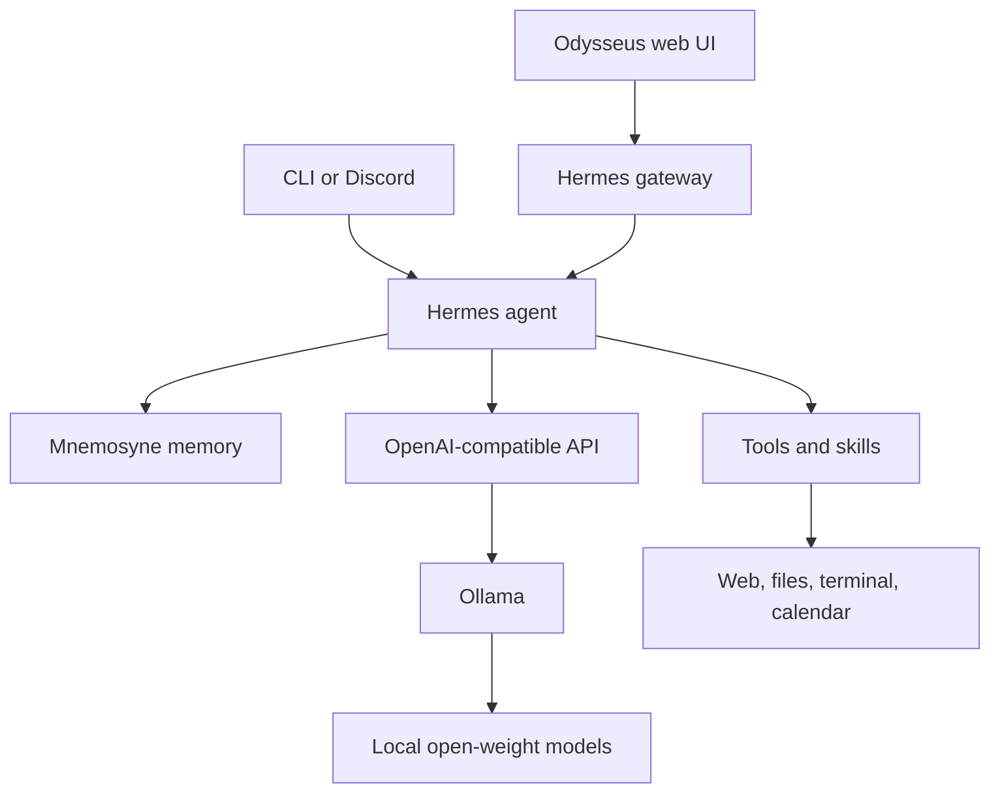

# Local-first AI assistant

### Hermes · Ollama · open-weight models · Linux

I run a personal assistant on my own desktop with [Hermes](https://github.com/nousresearch/hermes-agent) as the agent and Ollama serving open-weight models. It handles calendar changes, service checks, web lookups, and file tasks, and I reach it from the terminal, Discord, or a web UI. Model inference stays on my machine.

This repository holds the parts that are safe to publish: architecture notes, benchmark tooling, test harnesses, raw results, and what I learned choosing and tuning models on consumer hardware.

## Highlights

- Picked the production model with a six-case reliability suite run inside the real agent, after a speed-based pick failed on real tasks ([results](benchmarks/model-results.md#round-2-real-hermes-agent-loop))
- Re-tuned the stack after losing 8 GB of RAM: moved KV cache to q8_0 (1.2 GB of VRAM saved at 128K), measured fit under systemd memory limits, and cut context to 64K when 128K did not fit
- Wrote a Bash benchmark tool and Python harnesses for prefill, near-window recall, tool-call reliability, and calendar JSON correctness
- Tracked RAM, swap, memory pressure, and VRAM during every run, and added a guard that aborts a test before it starves the desktop
- Connected Hermes to Discord, Mnemosyne memory, and the Odysseus web UI, and verified the gateway path end to end

## Architecture

Component roles and trust boundaries are in [docs/architecture.md](docs/architecture.md).

## Current setup

Confirmed against the live install on 2026-11-05.

| Layer | Configuration |
|---|---|
| Agent | Hermes: tools, sessions, scheduling |
| Inference | Ollama on loopback, called through its OpenAI-compatible `/v1` endpoint |
| Primary model | Qwen3.6 35B-A3B UD-Q4_K_M (34.7B MoE), 65,536-token context, q8_0 KV cache |
| GPU headroom | 3 GiB of VRAM reserved for the desktop and other apps |
| Reasoning | `medium` |
| Secondary model | Ornith 1.5 9B Q4_K_M for image input and context compression |
| Interfaces | CLI, Discord gateway, Odysseus web UI through the Hermes gateway |
| Memory | Mnemosyne, with a daily ingest and consolidation job |

## Hardware

| Component | Configuration |
|---|---|
| CPU | Intel Core i5-13600KF |
| GPU | AMD Radeon RX 9070, 16 GB VRAM |
| RAM | 24 GB DDR4 (32 GB until one stick failed) |
| OS | CachyOS Linux |

### Hardware change: 32 GB to 24 GB

In fall 2026 one of my RAM sticks died, which dropped the machine from 32 GB to 24 GB. Around the same time I started using this PC much more for everyday work and games, so the browser and desktop now hold part of the 16 GB GPU too. Models get less RAM for offloaded layers and less VRAM than before.

That changed how I test:

- Fit is now a test of its own. A model has to load at the target context under the same systemd memory limits as production, with my normal desktop running.
- Every benchmark records available RAM, swap traffic, memory pressure, and VRAM use, and a guard script aborts runs that push the host too far.
- I moved KV cache from f16 to q8_0 and tested smaller models (9B to 14B) that fit entirely on the GPU.
- Speed alone no longer decides. The November tests run inside the real agent and score iterations, unnecessary actions, and whether the model stops when it should.

The production context dropped from 128K to 64K as a result. The full write-up is in [benchmarks/model-results.md](benchmarks/model-results.md#why-the-testing-changed).

## Model evaluation

The November 2026 retune on 24 GB ran in four rounds:

| Round | Test | Outcome |
|---|---|---|
| 1 | Throughput, KV cache, long prompts, minimal tool loop, calendar JSON | Ornith 9B looked best on speed |
| 2 | Six-case suite inside Hermes, including a read-only audit of my real calendar | Qwen 6/6 with 0 extra actions. Ornith 3/6 with 13 |
| 3 | Production fit under memory limits | 128K failed, 64K deployed |
| 4 | Ministral 3 14B and Gemma4 12B inside Hermes | Neither beat Qwen |

Round 2 reversed round 1. Ornith decodes more than twice as fast as Qwen, but inside Hermes it took twice as many iterations and invented a pagination flag. Qwen finished every case and stopped when the task was done.

| Model | Fits in VRAM at 128K | Warm decode | Hermes suite + calendar |
|---|---|---:|---|
| Qwen3.6 35B-A3B UD-Q4_K_M | No (~9.8 GB on CPU) | 37.5 tok/s | 6/6 |
| Gemma4 12B Q4_K_M | Yes | 94.4 tok/s | 4/6 |
| Ornith 1.5 9B Q4_K_M | Yes | 86.9 tok/s | 3/6 |
| Ministral 3 14B Q4_K_M | No (24% CPU) | 11.2 tok/s | 0/6 |

Decode speeds use q8_0 KV. Gemma's calendar case was synthetic, not the real-calendar audit. Each case ran once, so these are directional. Full tables, failure details, and the earlier 32 GB results are in [benchmarks/model-results.md](benchmarks/model-results.md). Raw CSV and JSON are in [results/2026-11-03-24gb/](results/2026-11-03-24gb/).

## Tooling

| Path | Purpose |
|---|---|
| [`scripts/benchmark_ollama.sh`](scripts/benchmark_ollama.sh) | Fixed-prompt decode and prefill benchmark with a CSV output. Seed, temperature, thinking mode, and output cap are fixed |
| [`scripts/harness/run_benchmark.py`](scripts/harness/run_benchmark.py) | Runs the benchmark while sampling RAM, swap, memory pressure, and VRAM every second |
| [`scripts/harness/reliability_openai.py`](scripts/harness/reliability_openai.py) | Five-case tool reliability suite with simulated helpers |
| [`scripts/harness/calendar_checks.py`](scripts/harness/calendar_checks.py) | Google Calendar PATCH correctness against a fake event |
| [`scripts/harness/prefill.py`](scripts/harness/prefill.py) | Cold prefill against prefix-cache reuse on a ~27K-token prompt |
| [`scripts/harness/context_probe.py`](scripts/harness/context_probe.py) | Recall of three anchors in a ~115K-token prompt |
| [`scripts/harness/memory_guard.py`](scripts/harness/memory_guard.py) | Aborts a run if RAM or memory pressure crosses a limit, and refuses to start while production has a model loaded |

Usage is in [scripts/README.md](scripts/README.md).

## Reliability suite

Each scenario has a pass condition and a stop condition. A model fails if it takes actions the task did not need, even when it reaches the right answer.

1. Use the authentication helper and stop after success.
2. Recover a revoked token and stop when user consent is required.
3. Repair a broken service through its maintained helper, verify, and stop.
4. Find a missing `API_KEY` without inventing a value.
5. Answer a current-data question from an authoritative live source.
6. Audit ten recurring calendar events, recover from an injected HTTP 503, and stop when the results are complete.

Definitions are in [benchmarks/reliability-suite.md](benchmarks/reliability-suite.md).

## Privacy

This repository holds documentation, harness code, and sanitized metrics only. It leaves out credentials and tokens, personal memory, private prompts, session logs, Discord identifiers, calendar contents, and the live configuration. The calendar audit in round 2 read my real calendar, so only its pass/fail counts and tool sequences are published. [SECURITY.md](SECURITY.md) lists the publication rules.

## Roadmap

- [x] Local inference through Ollama
- [x] CLI, Discord, and web UI access
- [x] Reliability suite with explicit stop conditions
- [x] Benchmark script with sanitized CSV output
- [x] Model selection inside the real agent loop
- [x] Re-tune for 24 GB RAM with memory telemetry
- [ ] Run the suite three times per case with `medium` reasoning at 64K
- [ ] Publish a sanitized configuration example
- [ ] Add screenshots of the agent and benchmark runs
- [ ] Add CI that runs `shellcheck`, `bash -n`, and a secret scan
